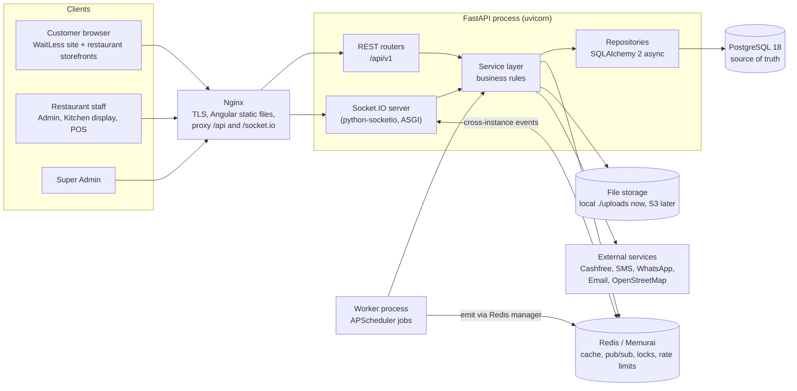
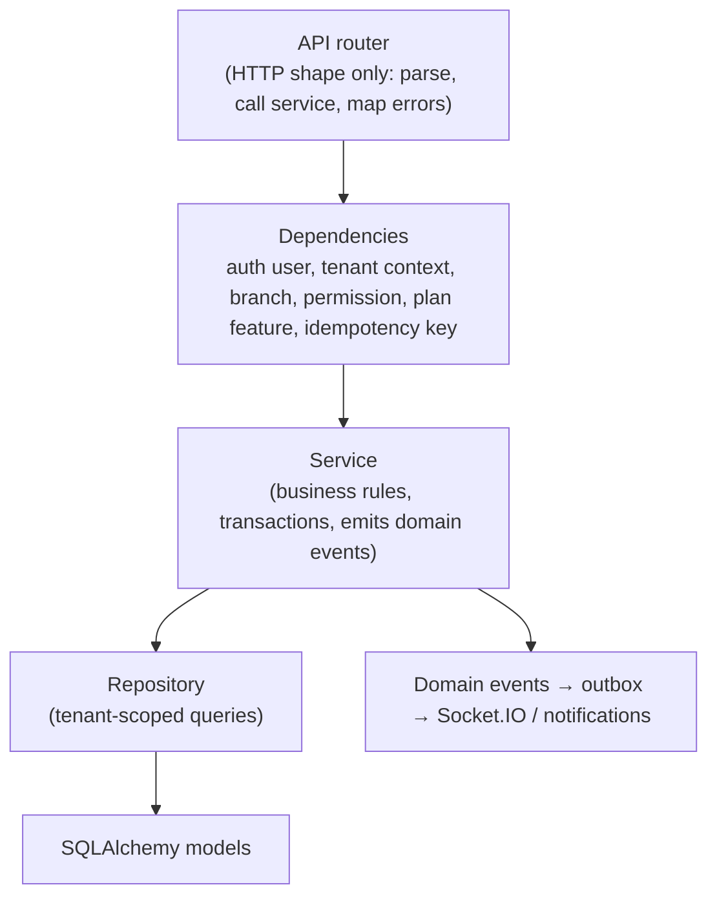
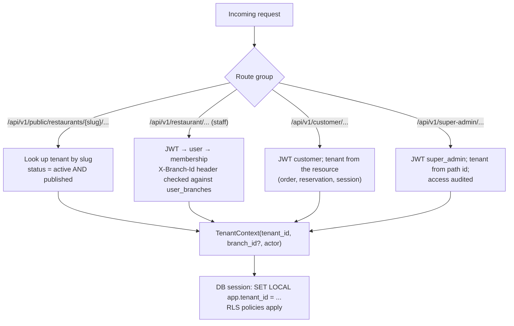
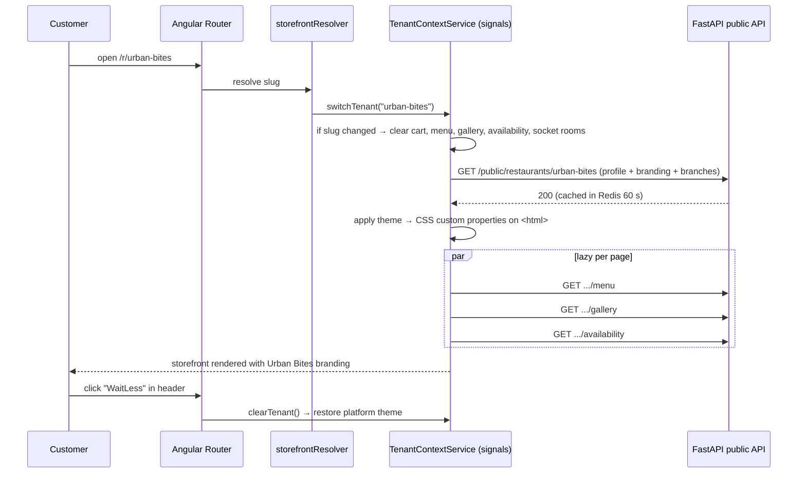
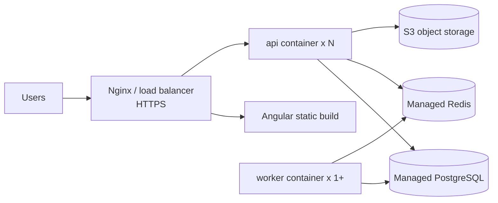

# 01 — System Architecture

## 1. Big picture

WaitLess is **one** Angular application and **one** FastAPI application (a modular monolith) serving every restaurant. Restaurants are tenants in a shared PostgreSQL database.

**Local development** has no Nginx: Angular dev server on `http://localhost:4200` proxies `/api` and `/socket.io` to FastAPI on `http://localhost:8000`.

## 2. Runtime components

| Component | Tech | Responsibility |
|---|---|---|
| Frontend | Angular 20+, standalone components, Signals, RxJS, Router, Reactive Forms, Angular Material (admin), Bootstrap 5 + SCSS (public), Socket.IO client, Chart.js, Leaflet | Four layouts (platform site, storefront, restaurant admin, super admin) + customer account |
| API | FastAPI, Pydantic v2, SQLAlchemy 2 (async, asyncpg), Alembic | REST endpoints, validation, auth, tenancy, business services |
| Real-time | python-socketio `AsyncServer` mounted on the same ASGI app, `AsyncRedisManager` | Push queue/table/order/SLA/kitchen updates to authorised rooms |
| Worker | APScheduler (async), Redis lock per job | Reservation expiry, SLA step events, low-stock/expiry checks, notification retries, subscription renewals |
| Database | PostgreSQL 18 | All business state; RLS; constraints for money, inventory, tables, reservations |
| Cache / coordination | Redis protocol (Memurai locally) | Public storefront cache, Socket.IO pub/sub, distributed locks, rate limiting, OTP throttling |
| Storage | `StorageBackend` interface → `LocalStorage` (now), `S3Storage` (later) | Logos, gallery, food images, licences, invoices (PDF) |

## 3. Layered backend

Rules:

- Routers never touch the database directly.
- Services own transactions (`async with uow:`). A request = at most one unit of work.
- Domain events are written to an `outbox_events` table **in the same transaction**; after commit they are broadcast. This is how "persist before broadcast" (PRD §24) is guaranteed.

## 4. Multi-tenancy

### 4.1 Tenant resolution — never from the client body

### 4.2 Isolation layers

1. **Application**: every tenant-owned repository requires a `TenantContext`; there is no un-scoped query method for tenant tables.
2. **Database (RLS)**: tenant tables have `tenant_id = current_setting('app.tenant_id')::uuid` policies. The app connects as a non-owner role so RLS cannot be skipped. Super Admin uses an explicit, audited elevation that sets `app.bypass_rls` for the transaction.
3. **Referential**: parents expose `UNIQUE (tenant_id, id)`; children reference `(tenant_id, parent_id)`, so a row can never point at another tenant's row.
4. **Real-time**: socket rooms embed the tenant id and every `join` is re-authorised.
5. **Cache**: every cache key is prefixed `t:{tenant_id}:`.

## 5. Dynamic storefront (PRD §2, §20)

Key points:

- **Theme without rebuild**: branding is a JSON of design tokens (`primary`, `secondary`, `accent`, `background`, `surface`, `text`, `radius`, `buttonStyle`, `mode`). `ThemeService` writes them as CSS variables; all storefront SCSS uses only those variables. The default token set is the Remelle theme (decision D1).
- **No leakage**: every tenant-scoped store is keyed by tenant id and cleared on switch; responses that arrive for a previous tenant are discarded (`switchMap` + tenant id check).
- **WaitLess link** is part of the storefront header component itself, not configurable away.

## 6. Real-time design

| Room | Members | Typical events |
|---|---|---|
| `t:{tid}:b:{bid}:staff` | Authorised staff of branch | `queue.updated`, `table.status_changed`, `reservation.*`, `order.placed`, `inventory.low_stock` |
| `t:{tid}:b:{bid}:kitchen` | Kitchen staff | `kitchen.ticket_created`, `kitchen.ticket_updated` |
| `t:{tid}:b:{bid}:public` | Anyone viewing storefront | `availability.changed`, `waittime.changed` (no personal data) |
| `session:{session_id}` | Customers who joined the table session | `order.status_changed`, `sla.tick_boundary`, `discount.changed`, `bill.updated` |
| `queue_entry:{id}` | The queued customer | `queue.position_changed`, `queue.table_ready` |
| `platform:admin` | Super Admins | `restaurant.registered`, `support.ticket_created` |

**Timers are not pushed every second.** The server sends `sla_started_at`, `serving_deadline`, policy snapshot and its current time; the client counts down locally (corrected for clock skew). The worker emits an event only at **discount boundaries** (15, 20, 25 … min) and on status changes, so the authoritative discount is always server-computed.

## 7. Background jobs (worker)

| Job | Trigger | Notes |
|---|---|---|
| `expire_reservations` | every 1 min | Only reservations in `confirmed` and **not checked-in**; row lock `FOR UPDATE SKIP LOCKED`; never touches a checked-in table (PRD §12) |
| `sla_boundaries` | scheduled at each next boundary per running SLA | Recomputes discount, persists `order_discounts`, emits event |
| `dispatch_outbox` | every 1 s | Fallback broadcaster for events not sent inline |
| `notify_retry` | every 1 min | Exponential back-off on failed deliveries |
| `inventory_alerts` | every 15 min + on movement | Low stock, out of stock, expiring in N days |
| `subscription_renewals` | daily | Renew, mark past-due, suspend after grace |
| `waittime_stats` | every 10 min | Refresh rolling occupancy averages per branch |

## 8. Cross-cutting concerns

| Concern | Approach |
|---|---|
| AuthN | JWT access token (15 min) in memory; refresh token (14 days) in HttpOnly, Secure, SameSite=Strict cookie; **rotation with reuse detection** (family revoked on reuse) |
| Passwords | Argon2id |
| AuthZ | Permission keys checked by a FastAPI dependency; branch scope via `user_branches`; plan feature gates (doc 04) |
| Idempotency | `Idempotency-Key` header required on order, payment, refund, booking-create; stored with request hash and response for 24 h |
| Concurrency | Row locks + constraints: partial unique index for one open assignment per table, GiST exclusion for overlapping reservations, unique `(order_item_id)` on inventory consumption, unique gateway payment id |
| Validation | Pydantic v2 on input; DB `CHECK` constraints on money ≥ 0, percentages 0–100, quantities > 0 |
| Uploads | MIME sniffing (not extension), size limits, re-encode images to WebP with Pillow, strip EXIF, random file names, served from `/media/` with no script execution |
| Rate limiting | Redis sliding window: OTP send (3 / 10 min / phone), login, public search |
| Audit | `audit_logs` row for every privileged write (who, tenant, entity, before/after diff, IP) |
| Time | All timestamps `timestamptz`, stored UTC, generated by the DB/server — never from the client |
| Config | `.env` + Pydantic Settings; `.env.example` committed, real `.env` ignored |
| Logging | Structured JSON logs with request id, tenant id, user id |
| API docs | FastAPI OpenAPI at `/api/docs` (Swagger) and `/api/redoc` |

## 9. Deployment (later phase)

Docker images and `docker-compose.yml` (api, worker, postgres, redis, nginx) are produced in Phase 1 for deployment, even though local development runs natively on Windows.
