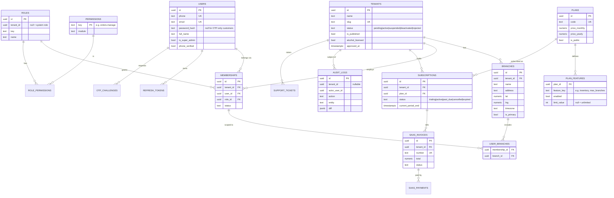
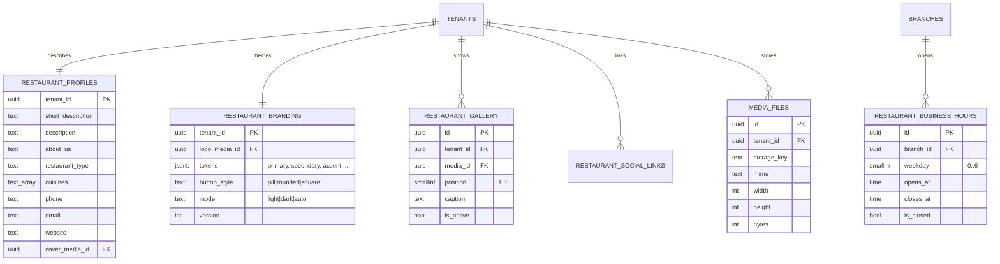
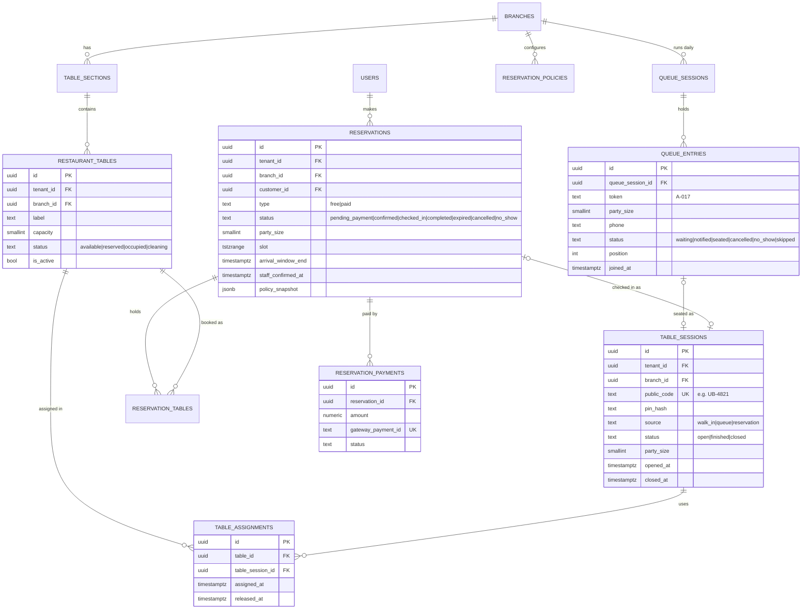
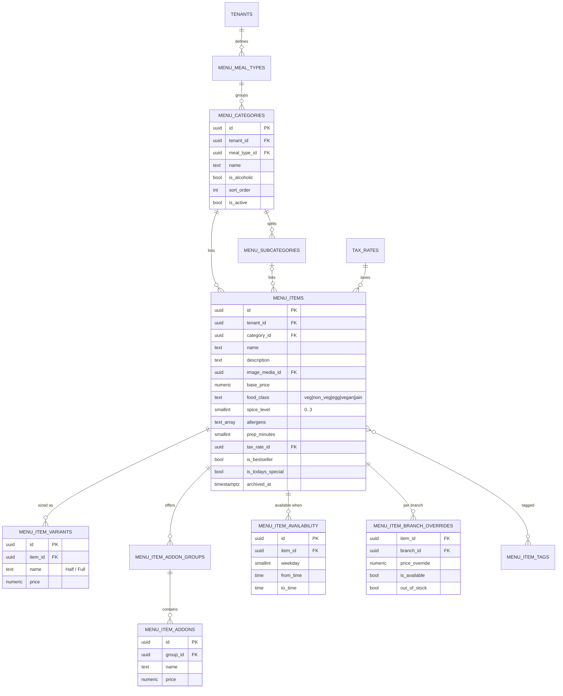
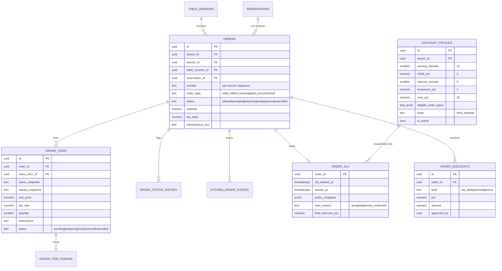
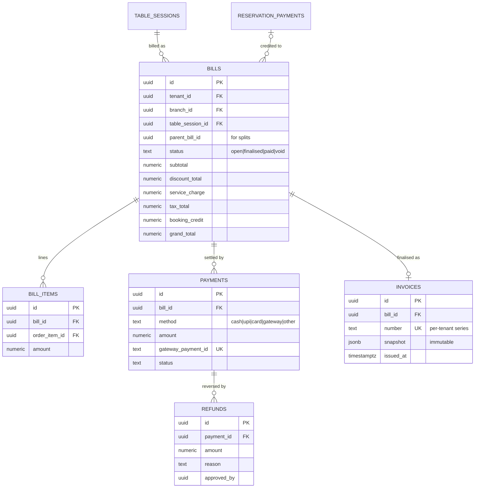
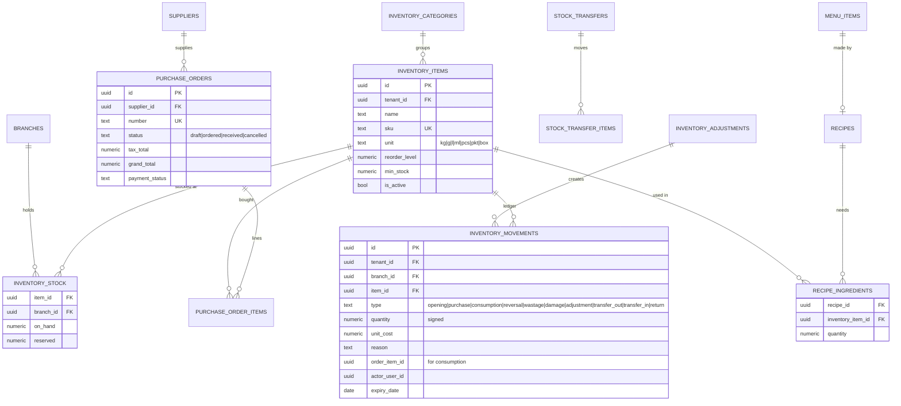
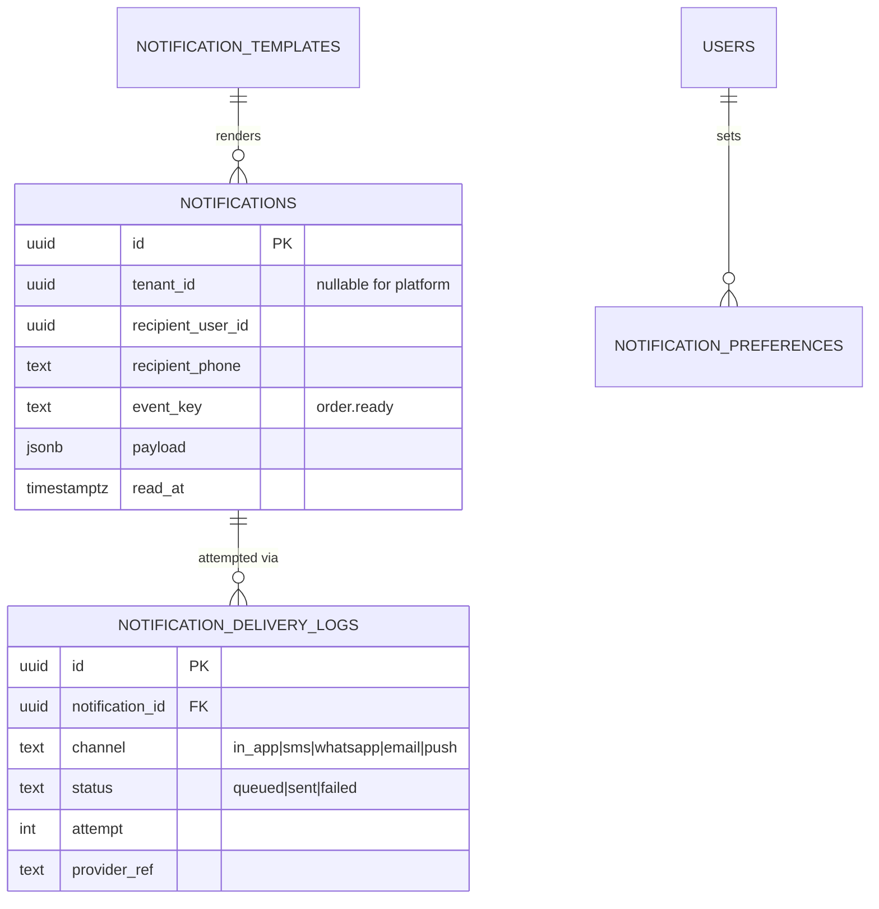

# 02 — Database ER Diagram

PostgreSQL 18, schema `public`, migrations via Alembic. Diagrams are split by module; only key columns are shown. Full column definitions are written in the Alembic migrations of each phase.

## Conventions (apply to every table)

| Rule | Detail |
|---|---|
| Primary key | `id uuid DEFAULT uuidv7()` |
| Tenant-owned tables | `tenant_id uuid NOT NULL` + `UNIQUE (tenant_id, id)`; branch-owned tables also `branch_id uuid NOT NULL` |
| Foreign keys between tenant tables | Composite: `FOREIGN KEY (tenant_id, x_id) REFERENCES x (tenant_id, id)` — blocks cross-tenant links |
| RLS | Enabled on every table that has `tenant_id` |
| Timestamps | `created_at`, `updated_at timestamptz NOT NULL DEFAULT now()`; all UTC |
| Soft delete | `archived_at timestamptz NULL` where history must survive (menu items, tables, employees) |
| Money | `NUMERIC(12,2)`, `CHECK (>= 0)`; percentages `NUMERIC(5,2) CHECK (BETWEEN 0 AND 100)` |
| Quantities (inventory) | `NUMERIC(14,3)` in the item's base unit |
| Enums | PostgreSQL `text` + `CHECK (... IN (...))` (easier to evolve than native enums) |
| Snapshots | Orders, bills and invoices copy names, prices, tax rates and policies at the time of the transaction |

Legend: `PK` primary key, `FK` foreign key, `UK` unique.

---

## 1. Platform, identity & SaaS

Also in this group (not drawn): `refresh_tokens` (family id, hash, revoked_at), `otp_challenges`, `idempotency_keys`, `outbox_events`, `platform_settings`, `platform_content` (landing-page CMS blocks), `support_tickets`, `support_notes`, `alcohol_licences`.

**Key constraints**
- `memberships UNIQUE (tenant_id, user_id)` — one role per user per restaurant.
- `subscriptions`: partial unique index `ON (tenant_id) WHERE status IN ('trialing','active','past_due')` — one live subscription per tenant.
- **Restaurant billing tables never reference SaaS billing tables and vice versa** (PRD §9).

---

## 2. Restaurant profile & branding

**Key constraints**
- Gallery: `UNIQUE (tenant_id, position) WHERE is_active` and `CHECK (position BETWEEN 1 AND 5)` → at most five active photos, enforced by the database. The service also checks the platform setting `gallery_max_photos` so the limit can change via config + migration.
- Branding `tokens` validated by Pydantic (hex colours, WCAG contrast warning in the UI). "Reset to default" writes the default token set and bumps `version`.

---

## 3. Tables, queue & reservations

**Key constraints**
- No double assignment: `UNIQUE (table_id) WHERE released_at IS NULL` on `table_assignments`.
- No overlapping bookings: `reservation_tables` carries `slot tstzrange` and `EXCLUDE USING gist (table_id WITH =, slot WITH &&) WHERE (active)` (needs `btree_gist`).
- Expiry job only updates rows `WHERE status = 'confirmed' AND staff_confirmed_at IS NULL` — a checked-in reservation can never be expired.
- `public_code` is unique among **open** sessions per tenant: `UNIQUE (tenant_id, public_code) WHERE status <> 'closed'`.

---

## 4. Menu

**Key constraints**
- Alcohol: a trigger/service check refuses activating `is_alcoholic` categories unless `tenants.alcohol_licensed = true`.
- Default meal types and categories (PRD §7.1–7.2) are **seeded per tenant on registration** and remain editable.
- `MENU_ITEM_TAGS` is many-to-many through `menu_item_tag_links`.

---

## 5. Orders, kitchen, SLA & discounts

**Key constraints**
- `ORDER_SLA.sla_started_at` is set **only** by the server: on `accepted` (walk-in / staff order), on `arrival confirmed + accepted` (free booking), on `staff_confirmed_at` (paid pre-order). Stored once; a `CHECK` + trigger prevents overwriting.
- `UNIQUE (tenant_id, idempotency_key)` on orders prevents duplicate submissions.
- Only one `sla_delay` discount row per order (`UNIQUE (order_id) WHERE kind='sla_delay'`), updated at each boundary until served, then frozen.

---

## 6. Billing & payments (restaurant side)

**Key constraints**
- `INVOICES` rows are insert-only (trigger rejects `UPDATE`/`DELETE`). Corrections are **credit notes** (`invoices.kind = 'credit_note'` referencing the original).
- `SUM(payments) - SUM(refunds) <= grand_total` checked in the service inside a `SERIALIZABLE` transaction.
- Webhook processing is idempotent on `gateway_payment_id`.

---

## 7. Inventory

**Key constraints**
- The **movement ledger is the truth**; `inventory_stock.on_hand` is a cache maintained in the same transaction (and reconcilable by a report).
- Movements are insert-only; `reason` and `actor_user_id` are `NOT NULL` for adjustments, wastage and damage (PRD §8.2 "never modify stock silently").
- One deduction per order line: `UNIQUE (order_item_id, item_id) WHERE type = 'consumption'`.
- `CHECK (on_hand >= 0)` unless the branch setting `allow_negative_stock` is on.

---

## 8. Notifications

---

## 9. Migration order

Migrations are created phase by phase (see [07-development-plan.md](07-development-plan.md)):

1. Phase 1 — extensions (`btree_gist`, `citext`, `pg_trgm`), roles, `outbox_events`, `idempotency_keys`, `audit_logs`, RLS helper functions.
2. Phase 2 — identity, tenants, branches, roles/permissions, plans, subscriptions.
3. Phase 3 — profile, branding, gallery, hours, media.
4. Phase 5 — tables, sections, sessions, assignments.
5. Phase 6 — queue, reservations.
6. Phase 7 — menu, orders, kitchen.
7. Phase 8 — SLA, discount policies.
8. Phase 9 — inventory.
9. Phase 10 — bills, payments, refunds, invoices.
10. Phase 11 — SaaS invoices/payments, analytics materialised views.
