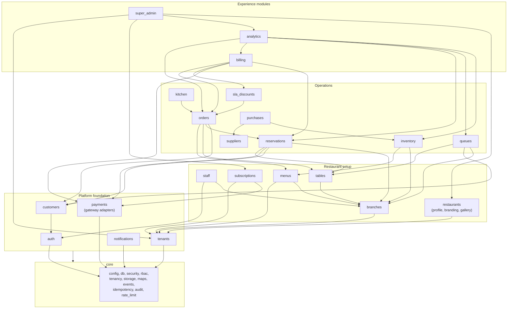
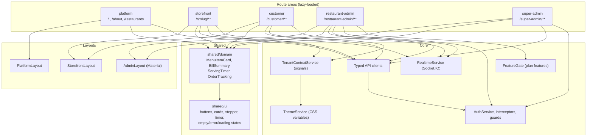

# 03 — Module Dependencies

Arrows mean "depends on / calls". Dependencies only point **downwards**; a lower module never imports a higher one. Upward communication happens through **domain events** (outbox), e.g. `orders` emits `order.accepted` and `inventory` listens.

## 1. Backend modules



### Event subscriptions (cross-module, decoupled)

| Event (producer) | Consumers |
|---|---|
| `order.accepted` (orders) | sla_discounts (start timer for walk-in/free), inventory (deduct), kitchen (ticket), notifications |
| `order.served` (orders) | sla_discounts (freeze discount), billing (update open bill) |
| `order.cancelled` (orders) | inventory (reverse), billing |
| `reservation.arrival_confirmed` (reservations) | sla_discounts (start timer for paid pre-orders), tables |
| `reservation.expired` (reservations) | tables (release), payments (refund/forfeit per policy), notifications |
| `queue.table_ready` (queues) | notifications |
| `inventory.low_stock` (inventory) | notifications |
| `payment.captured` (payments) | reservations, billing, subscriptions |
| `tenant.activated` (tenants) | restaurants (publish check), subscriptions |
| `table_session.finished` (tables) | billing (finalise bill) |

### Backend folder layout

```
backend/
  app/
    main.py                 # FastAPI + Socket.IO ASGI app
    worker.py               # APScheduler worker entry point
    core/                   # config, db, security, rbac, tenancy, storage, maps, events, audit
    api/v1/<module>/router.py
    models/<module>.py      # SQLAlchemy
    schemas/<module>.py     # Pydantic
    repositories/<module>.py
    services/<module>/      # business logic + event handlers
    websocket/              # socket auth, rooms, emitters
    tasks/                  # scheduled jobs
    integrations/           # cashfree, sms, whatsapp, email, osm
    seeds/                  # permissions, system roles, default plans, default menu taxonomy
  alembic/
  tests/  unit/ integration/ api/
  uploads/                  # local storage (git-ignored)
```

## 2. Frontend modules



### Frontend folder layout

```
frontend/src/app/
  core/          auth, http, tenant-context, theme, realtime, feature-gate, error-handling
  shared/ui/     generic presentational components
  shared/domain/ reusable restaurant components (PRD §20 list)
  layouts/       platform, storefront, admin
  features/
    platform/          landing, about, discovery, restaurant-registration, login
    storefront/        home, menu, gallery, about, contact, reservations, cart, join-table, order-tracking, bill
    customer/          profile, bookings, orders, notifications
    restaurant-admin/  dashboard, profile, branding, gallery, branches, employees, tables, queue,
                       reservations, orders, kitchen, menu, inventory, suppliers, purchases,
                       billing, payments, discounts, reports, settings
    super-admin/       overview, restaurants, plans, subscriptions, content, support, audit, settings
  app.routes.ts
src/styles/      tokens (default Remelle theme), storefront SCSS, material theme
```

### PRD §20 reusable components → location

| Component | Location | Inputs (no hard-coded restaurant data) |
|---|---|---|
| RestaurantHeaderComponent | shared/domain | `restaurant`, `cartCount`, `user` |
| RestaurantLogoComponent | shared/domain | `logoUrl`, `name`, `size` |
| RestaurantHeroComponent | shared/domain | `profile`, `availability` |
| RestaurantGalleryComponent | shared/domain | `images[]`, `mode: grid \| lightbox` |
| RestaurantMenuComponent | shared/domain | `menu`, `canOrder` |
| MenuCategoryComponent | shared/domain | `category` |
| MenuItemCardComponent | shared/domain | `item`, `canOrder` |
| RestaurantAvailabilityComponent | shared/domain | `availability`, `waitTime` |
| ReservationFormComponent | shared/domain | `policy`, `branches` |
| BookingOptionComponent | shared/domain | `type: free \| paid`, `fee` |
| CartComponent | shared/domain | `cart` (tenant-scoped store) |
| OrderTrackingComponent | shared/domain | `order` |
| ServingTimerComponent | shared/domain | `sla` (start, policy snapshot, server time) |
| BillSummaryComponent | shared/domain | `bill` |
| RestaurantFooterComponent | shared/domain | `restaurant` |
