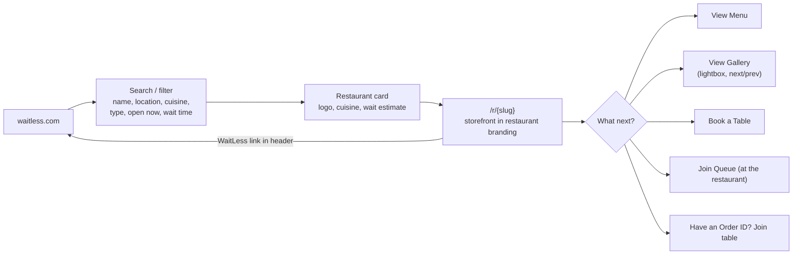
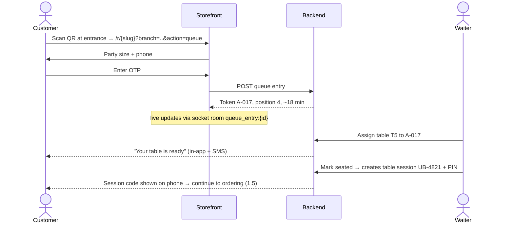
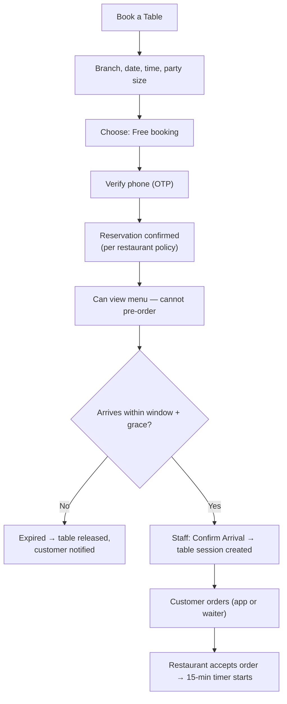
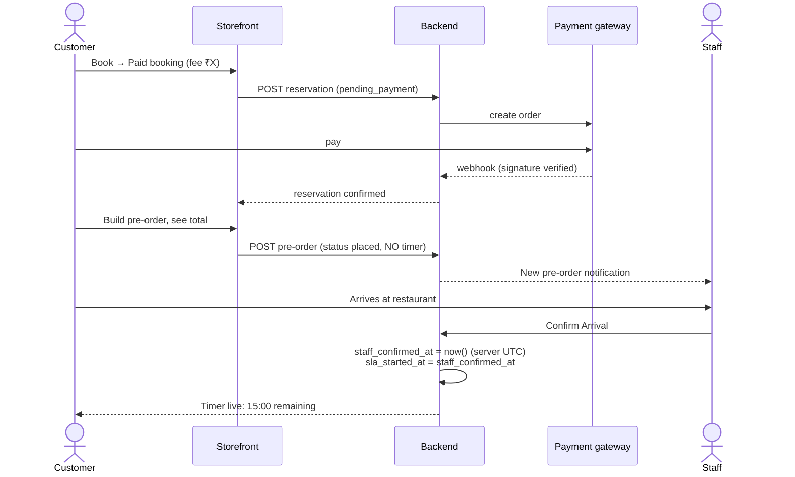
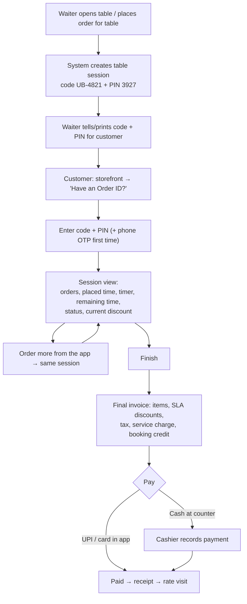
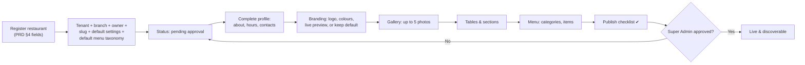
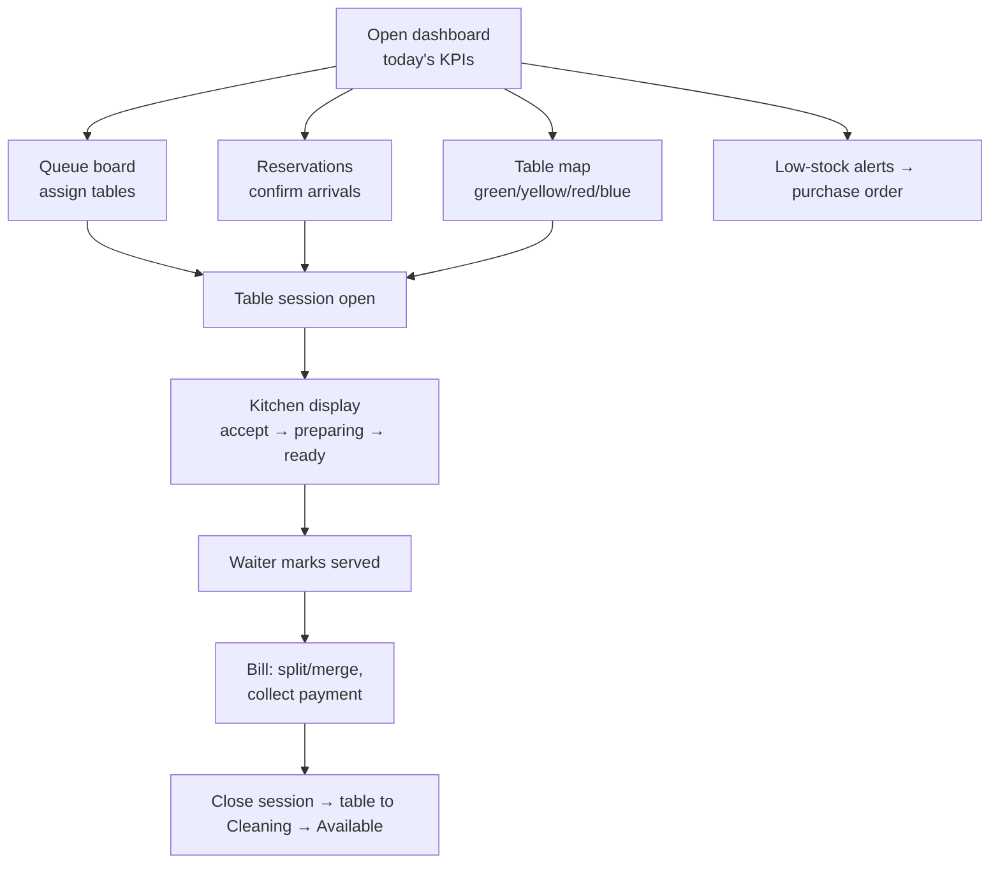
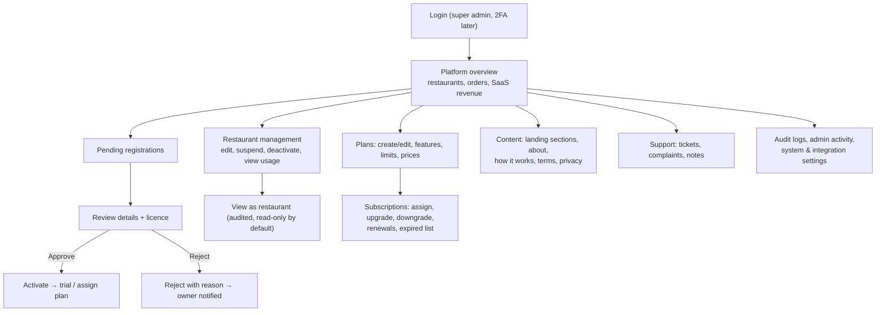

# 05 — User Journeys

## 1. Customer journeys

### 1.1 Discover → storefront

### 1.2 Walk-in via digital queue (PRD §10)

### 1.3 Free booking (PRD §12)

### 1.4 Paid booking with pre-order (PRD §12, §14)

### 1.5 Ordering through a table session — "Order ID" flow (PRD §13)

### 1.6 Serving timer & discount (PRD §14) — what the customer sees

| Minute (since timer start) | Shown |
|---|---|
| 0–15 | Countdown "12:40 left to serve", status chip, discount 0% |
| 15–20 | "Running late — 2% off this order", amount saved |
| 20–25 | 4% … up to the restaurant's max |
| Served | Timer stops; final discount frozen and copied to the bill |

## 2. Restaurant Admin journeys

### 2.1 Onboarding

Publish checklist (all required to be discoverable): approved + active subscription/trial, logo or name, cover image, address with map pin, opening hours, at least one table, at least one active menu item.

### 2.2 Daily operation (one service)

### 2.3 Back-office

| Area | Main tasks |
|---|---|
| Menu | Meal types, categories, sub-categories, items, variants, add-ons, availability windows, bestseller / today's special |
| Inventory | Opening stock, purchases, wastage/damage with reason, transfers between branches, recipe mapping |
| Discounts | SLA policy (serving minutes, initial, interval, increment, max, eligible order types) |
| Staff | Invite employee (phone/email), assign role & branches, deactivate |
| Reports | Sales, orders, serving time & delays, discounts given, inventory valuation & wastage |
| Subscription | Current plan, usage vs limits, upgrade, pay SaaS invoice |

## 3. Super Admin journeys

