# 07 — Development Plan

## 1. How each phase is run

1. Build backend (models → migration → repositories → services → routers → tests), then frontend, then end-to-end checks.
2. A phase is **done** only when frontend, backend, database and tests for its features exist and pass (PRD §29).
3. Phase report, every time: features implemented · files created/modified · database changes · APIs · test results · known issues · how to run.
4. One Git commit (or a small series) per phase; you review before the next phase starts.

## 2. Phase map

```mermaid
flowchart LR
  P0["0 Planning ✔"] --> P1["1 Foundation"] --> P2["2 Auth & SaaS core"] --> P3["3 Profile & branding"] --> P4["4 Dynamic storefront"]
  P4 --> P5["5 Restaurant admin"] --> P6["6 Queue & reservations"] --> P7["7 Menu & ordering"] --> P8["8 SLA & discounts"]
  P8 --> P9["9 Inventory"] --> P10["10 Billing & payments"] --> P11["11 Analytics & SaaS admin"] --> P12["12 Production"]
```

Note: menu **management** (categories/items CRUD) moves up into Phase 4 in a minimal form, because the storefront menu page needs real data; Phase 7 adds variants, add-ons, availability windows and ordering.

## 3. Phases in detail

### Phase 1 — Foundation
- Monorepo layout; move template to `design/default-theme/`; `.gitignore`, `.editorconfig`, README.
- Backend: FastAPI app factory, Pydantic Settings, async SQLAlchemy + asyncpg, Alembic, structured logging, error envelope, health endpoint, Socket.IO mounted, Redis (Memurai) client, worker entry point, storage adapter (local), test setup (pytest, test database `waitless_test`).
- Database: extensions, `outbox_events`, `idempotency_keys`, `audit_logs` (append-only). The RLS app role moves to Phase 2 (decision D34).
- Frontend: Angular 21 workspace (decision D33), standalone + signals, routing skeleton for all 5 areas and 3 layouts, SCSS design tokens from the default theme, Angular Material theme, Bootstrap 5 grid, API client base, error/loading/empty components, Playwright + unit test setup.
- Infra (for later deployment): Dockerfiles, `docker-compose.yml`, Nginx config.
- **Acceptance:** `GET /api/health` reports DB + Redis OK; Angular shows the platform layout shell; `pytest` and `ng test` green.

### Phase 2 — Authentication & SaaS core
- Database role `waitless_app` (non-owner) + RLS helper functions and policies.
- Users, OTP (dev: printed to log), password login, JWT + refresh rotation, `/me`.
- Tenants, branches, memberships, roles/permissions seeds, permission & branch dependencies, RLS policies.
- Plans + plan features seeded (Starter/Professional/Enterprise), subscriptions with trial.
- Restaurant registration flow (PRD §4 steps 1–7); Super Admin approve/reject/activate/suspend/deactivate. Default menu taxonomy moves to Phase 4 (decision D36).
- Super Admin seed account via CLI command.
- **Acceptance (PRD tests 1, 2, 16):** Super Admin registers and activates a restaurant; owner logs in; owner of A gets 404 on B's records (API and RLS level).

### Phase 3 — Restaurant profile & branding
- Profile, hours, social links, media upload pipeline (validation, WebP, EXIF strip), logo & cover, gallery (max 5, reorder, replace), theme tokens with live preview and **Reset to default**, publish checklist, public storefront APIs with Redis caching.
- **Acceptance (test 3):** owner uploads logo + 5 photos; 6th is rejected; preview matches saved theme.

### Phase 4 — Dynamic storefront & platform site
- WaitLess landing, about, how it works, features, for restaurants, contact; discovery with filters + OpenStreetMap map.
- Storefront layout: header (logo, name, nav, login, cart, **WaitLess link**), home, menu, gallery (lightbox), about, contact (map), theme applied from API; `TenantContextService` switching & clearing.
- Minimal menu management (categories, items, images) so storefront has real data, plus the PRD §7 default meal types/categories seeded for each restaurant (existing restaurants get them via a data migration).
- **Acceptance (tests 4, 5, 6):** two seeded restaurants with different branding; Playwright switches A → B → A and asserts no logo/menu/gallery/contact leakage.

### Phase 5 — Restaurant administration
- Admin layout, dashboard shell with real counters, branches, employees (invite, roles, branch scope, custom roles), table sections & tables, live table board (colours per status).
- **Acceptance:** concurrent double-assignment attempt → one succeeds, one gets `TABLE_ALREADY_ASSIGNED`.

### Phase 6 — Queue & reservations
- Digital queue (customer + staff), QR code per branch, live positions, wait-time estimate.
- Reservation policies, free & paid bookings, mock + Razorpay gateway, webhook verification, arrival confirmation, expiry job with grace period, refund/forfeit rules.
- **Acceptance (tests 8, 10, 17):** free booking confirmed; paid booking confirmed only after verified webhook; duplicate webhook ignored; checked-in reservation is never expired.

### Phase 7 — Menu & ordering
- Full menu: meal types, sub-categories, variants, add-ons, availability windows, branch overrides, tags, alcohol gating.
- Cart (tenant-scoped), customer ordering, staff ordering, **table session code + PIN flow**, pre-orders for paid bookings, kitchen display, status flow, Ready ≠ Served.
- **Acceptance (tests 7, 9):** owner creates categories/items; free-booking customer gets `PREORDER_NOT_ALLOWED`; duplicate order with same idempotency key returns the original.

### Phase 8 — SLA & discounts
- Discount policy screen, policy snapshot, timer start rules per order type, boundary scheduling in worker, live timer component, discount in session view and bill.
- **Acceptance (tests 11, 12):** paid pre-order SLA starts at arrival confirmation, not at order time; table-driven tests for minutes 15/16/20/21/35/120 against the PRD table and cap.

### Phase 9 — Inventory
- Items, units, stock per branch, movement ledger, adjustments with reasons, transfers, suppliers, purchase orders & receiving, recipes, deduction on Accept, reversal on cancel, alerts & reports.
- **Acceptance (test 13):** accepting an order deducts exact recipe quantities once; cancelling reverses; retrying accept does not double-deduct.

### Phase 10 — Billing & payments
- Bill generation from session, taxes, service charge, SLA discounts, booking credit, split/merge, manual discounts within limits, cash/UPI/card/gateway payments, refunds, immutable invoices + PDF receipt, customer Finish → pay in app.
- **Acceptance (test 14):** bill matches hand-calculated fixture (items, discount, tax, service charge, credit) to the paisa.

### Phase 11 — Analytics & SaaS admin
- Restaurant dashboard KPIs (PRD §15) and reports with CSV export, Chart.js charts.
- Super Admin overview, plans editor, subscriptions lifecycle, SaaS invoices & payments, content management, support tickets, audit log viewer, notifications admin (templates).
- **Acceptance (test 15):** Super Admin creates a new plan with custom limits and assigns it; limits enforced immediately.

### Phase 12 — Production readiness
- Security review (OWASP checklist, tenant-isolation test suite), load test (k6/Locust) on storefront and ordering, full Playwright suite, Docker deployment, Nginx + HTTPS, backups, monitoring/log shipping, S3 storage adapter, Google Maps adapter (when key is provided), real SMS/WhatsApp/email providers.

## 4. Local development setup (Windows, no Docker)

| Service | Where | Notes |
|---|---|---|
| PostgreSQL 18 | Windows service | Databases `waitless` (dev) and `waitless_test` (tests, created in Phase 1). App connects as role `waitless_app` (created in Phase 1). |
| Memurai | Windows service, `localhost:6379` | Used for cache, Socket.IO pub/sub, locks, rate limits |
| Backend | `backend/.venv` (Python 3.13) | `uvicorn app.main:app --reload` on :8000 and `python -m app.worker` |
| Frontend | Node 24 | `ng serve` on :4200 with proxy to :8000 |

Two terminals for backend (API + worker), one for frontend. A `scripts/dev.ps1` will start all three.

## 5. Risks & mitigations

| Risk | Mitigation |
|---|---|
| Scope is very large (26 deliverables) | Strict phase gates; each phase usable on its own |
| Cross-tenant leaks | RLS + composite FKs + dedicated isolation test suite run every phase |
| Timer/discount disputes | Server timestamps only, policy snapshots, boundary events, audit of manual overrides |
| Payment edge cases | Idempotency keys, webhook-first confirmation, reconciliation report |
| Windows vs Linux differences | Worker uses APScheduler (portable); Docker images tested in Phase 12 |
| Nominatim usage limits | Geocode only on address save, server-side, cached; swap to Google when key arrives |

## 6. Open items for later (not blocking Phase 1)

- Pricing for plans (amounts in INR).
- Real provider accounts: Razorpay, SMS, WhatsApp, email, Google Maps key.
- Whether Starter should include ordering (see note in [doc 04 §4](04-roles-permissions.md#4-plan-feature-gates-configurable-prd-17)).
- Final WaitLess logo.
